# gocmd

**Private, end-to-end encrypted group chat from the Windows command line.**
No accounts, no chat server, no history. Channels live in RAM and vanish when the last person leaves.

An illustration, not a recording: gocmd bans anyone who opens screen-recording software during a chat.

## Why gocmd
- **Invite-only.** You get in only with a one-time code someone inside gives you. It works once and expires after 3 minutes.
- **Nothing to read, even on the wire.** Messages are end-to-end encrypted; Wireshark sees only random bytes.
- **No host with special powers.** Everyone gets a random name. Kicking someone takes a vote.
- **Leaves no trail.** The screen wipes every 10 messages, idle people are kicked after 7 minutes, and the channel is gone when the last person leaves.
- **Hard to leak.** Screenshot and recording tools are blocked while you chat.

## Install (easy way)
1. Download **`gocmd-<version>.msi`** from [Releases](https://github.com/Margrina/gocmd/releases/latest) and double-click it. No admin rights and no Python needed.
2. Windows may show *"Windows protected your PC"* (the installer is not code-signed): click **More info** → **Run anyway**.
3. Open a **new** CMD window and type `gocmd -u NAME --new`. There is also a **gocmd** entry in the Start menu.

Uninstall from *Settings → Apps*. Your install file (`%LOCALAPPDATA%\gocmd\gocmd.lock`) is kept, so reinstalling just works.

## Install from source (git clone / ZIP)
1. Install Python 3.10+ from python.org and tick **Add python.exe to PATH**.
2. `git clone https://github.com/Margrina/gocmd` (or download the ZIP and extract it).
3. Double-click **`install.bat`** in the folder. It installs the libraries and makes `gocmd` a command.
4. Open a **new** CMD window and type `gocmd -u NAME --new`.

If gocmd ever says this computer "already has a gocmd install file", send the admin the computer name it shows. After the admin resets it, just run gocmd again - it fixes itself.

## Use
| Command | What it does |
|---|---|
| `gocmd -u NAME --new` | open a new channel (hosted on your own computer) |
| `gocmd -u NAME -o CODE` | join a channel with a one-time code |
| `/onecode` | make a join code - shown only to you, valid 3 minutes, single use |
| `/vote.kick.ALIAS` | start a 60-second kick vote |
| `/vote.ALIAS` / `/vote.no.ALIAS` | vote yes / no |
| `/members`, `/exit` | list members, leave |

Rules:
- Everyone gets a random alias; your username is never shown.
- The screen is wiped every 10 messages. 7 minutes without a message = kick.
- A kick passes when yes > no (non-voters don't count). A failed vote gives its starter a 3-minute cooldown; max 3 failed votes.
- A channel lives only in RAM. When the last member leaves it is gone forever.

## Privacy and encryption
- Two layers: transport (X25519 + ChaCha20-Poly1305, padded to 1 KiB) and end-to-end (the channel key never leaves the members). Packet sniffers such as Wireshark see only random bytes.
- The channel runs on the creator's computer and is reachable through a public tunnel (bore.pub), which only ever carries ciphertext. Join codes carry the host's fingerprint, so the host can't be impersonated.

## Screen capture and bans
- If screen recording / screenshot software is running, gocmd won't start. Opening it during a chat = **24-hour ban**.
- gocmd checks a central ban server at startup and every minute. If the server is unreachable, gocmd does not run.
- **What a ban is tied to:** public IP, computer name, MAC addresses, hardware identifiers (motherboard UUID and serial, disk serials, Windows MachineGuid) and a device ID that gocmd stores outside its folder (`%LOCALAPPDATA%\gocmd`, `%APPDATA%\gocmd`, `HKCU\Software\gocmd`). Deleting gocmd does not lift a ban.
- These identifiers are sent only as one-way hashes. When you are banned, your computer name and username are recorded with the ban.

## Server approval (anti-tamper)
- On first run gocmd creates `%LOCALAPPDATA%\gocmd\gocmd.lock`, an install file sealed by the gocmd server. Your computer can't read or change it. **Don't delete it:** without it you are offline until an admin resets your install.
- Every few minutes the server checks the install file, that `gocmd.py` is an unmodified official build, bans and the version, then issues a short-lived signed approval.
- Channels only accept members with a valid approval, and members only connect to an approved host. Modified copies, banned users and computers without approval can't talk to anyone.

## Updates
When a new version is published you are asked to update. Updates are signed by the owner and verified (signature + SHA-256) before gocmd replaces itself.

## License
gocmd is free software under the [GNU GPL v3](LICENSE): you can use, study, share and modify it, and any copy you share must stay open under the same license.
